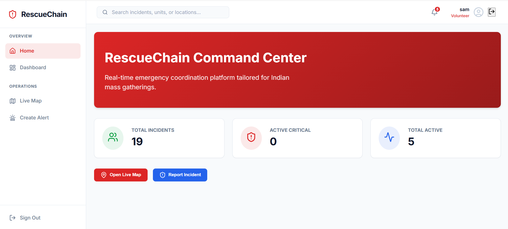
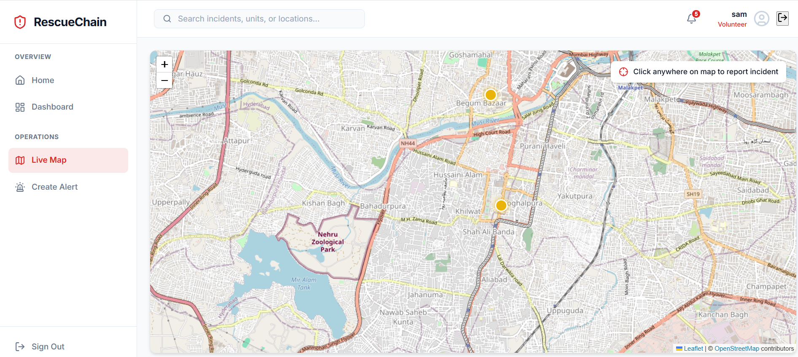
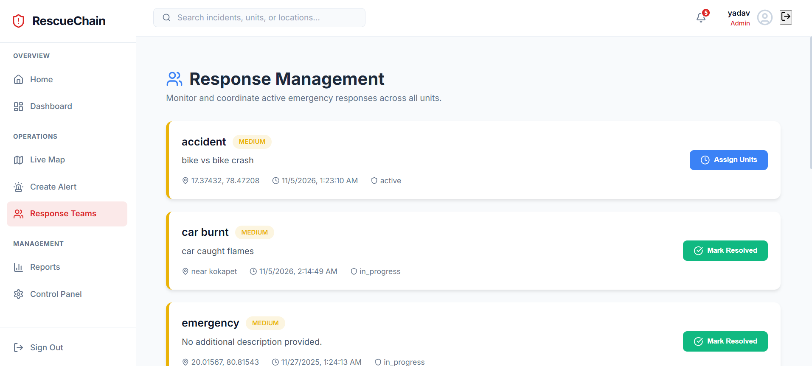
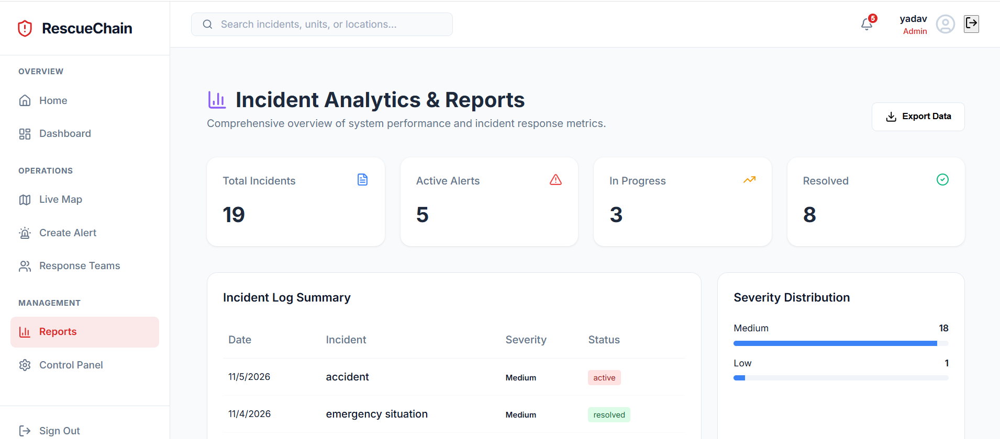

# RescueChain – Real-Time Emergency Reporting and Response Coordination Platform

**Live Demo:** https://rescue-chain-blond.vercel.app/

## Overview

RescueChain is a cloud-based emergency reporting and response coordination platform designed to support crowd disaster management during large public gatherings.

The platform enables volunteers to report emergencies in real time, while administrators can monitor reported incidents, assess their severity, and manage their resolution through a centralized dashboard.

## Key Features

- **Real-Time Emergency Reporting:** Volunteers can submit emergency alerts with incident descriptions and location information.
- **Interactive Map Dashboard:** Visualizes emergency incidents using geographical information.
- **Automated Severity Classification:** Uses keyword-based rules to classify incidents into Critical, High, Medium, and Low severity levels.
- **Role-Based Access Control:** Separate interfaces and permissions for Admin and Volunteer users.
- **Real-Time Data Synchronization:** Firebase Cloud Firestore enables updates to be reflected across the application.
- **Alert Management:** Administrators can monitor alerts and update their status from Active to In Progress and Resolved.
- **Authentication:** Firebase Authentication handles user registration and login.

## Technology Stack

| Component | Technologies |
|---|---|
| Frontend | React.js, Vite |
| Programming Language | JavaScript |
| Styling | CSS |
| Maps | Leaflet, React-Leaflet |
| Backend Services | Firebase |
| Authentication | Firebase Authentication |
| Database | Cloud Firestore |
| Deployment | Vercel |
| Version Control | Git, GitHub |

## Project Architecture

The deployed application uses a React-based frontend integrated directly with Firebase services.

- **React + Vite:** User interface and application logic.
- **Firebase Authentication:** User authentication and account management.
- **Cloud Firestore:** Stores user information and emergency alert records, with real-time data synchronization.
- **Firestore Security Rules:** Enforces role-based access and controls database operations.

The repository also contains a separate Express.js backend implementation using Firebase Admin SDK. It is not currently part of the deployed frontend's active request flow.

## User Roles

### Volunteer
- Register and log in to the platform.
- Report emergency incidents.
- Provide incident descriptions and location information.
- View reported alerts.

### Administrator
- Access the administrative dashboard.
- Monitor reported emergency incidents.
- Review incident severity.
- Manage alert status.
- Mark incidents as In Progress or Resolved.

## Alert Severity Classification

The platform uses keyword-based classification rules to determine incident severity.

- **Critical:** Examples include fire, stampede, bomb and fatal incidents.
- **High:** Examples include injuries, medical emergencies and collapses.
- **Medium:** Examples include crowd-related issues, theft and lost-person reports.
- **Low:** Other incidents that do not match the higher-severity rules.

## Project Structure

```text
RescueChain/
├── backend/
│   ├── config/
│   ├── controllers/
│   ├── routes/
│   ├── services/
│   └── server.js
│
├── frontend/
│   ├── public/
│   ├── src/
│   │   ├── components/
│   │   ├── context/
│   │   ├── pages/
│   │   └── services/
│   ├── package.json
│   └── vercel.json
│
├── .gitignore
└── README.md
```

## Running the Frontend Locally

### Prerequisites
- Node.js and npm
- Firebase project configuration

### Installation

1. Clone the repository:

```bash
git clone https://github.com/Kalyandeep090/RescueChain.git
```

2. Navigate to the frontend directory:

```bash
cd RescueChain/frontend
```

3. Install dependencies:

```bash
npm install
```

4. Start the development server:

```bash
npm run dev
```

5. Open the local URL provided by Vite, usually:

```text
http://localhost:5173
```

Ensure the Firebase web configuration in `frontend/src/services/firebase.js` is configured for your Firebase project.

## Deployment

The frontend is deployed on Vercel.

**Live Application:** https://rescue-chain-blond.vercel.app/

Firebase Authentication and Cloud Firestore provide the application's backend services.

## Future Enhancements

- Integration with actual emergency response agencies.
- Advanced incident prioritization and analytics.
- Enhanced location tracking and geospatial filtering.
- Notification mechanisms for critical incidents.
- Additional monitoring and reporting capabilities.
## 📸 Project Screenshots

### 1. Volunteer Home


### 2. Live Emergency Map


### 3. Response Management


### 4. Incident Analytics & Reports



## Repository

GitHub: https://github.com/Kalyandeep090/RescueChain
